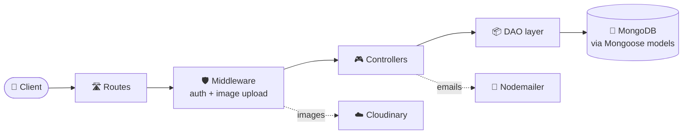
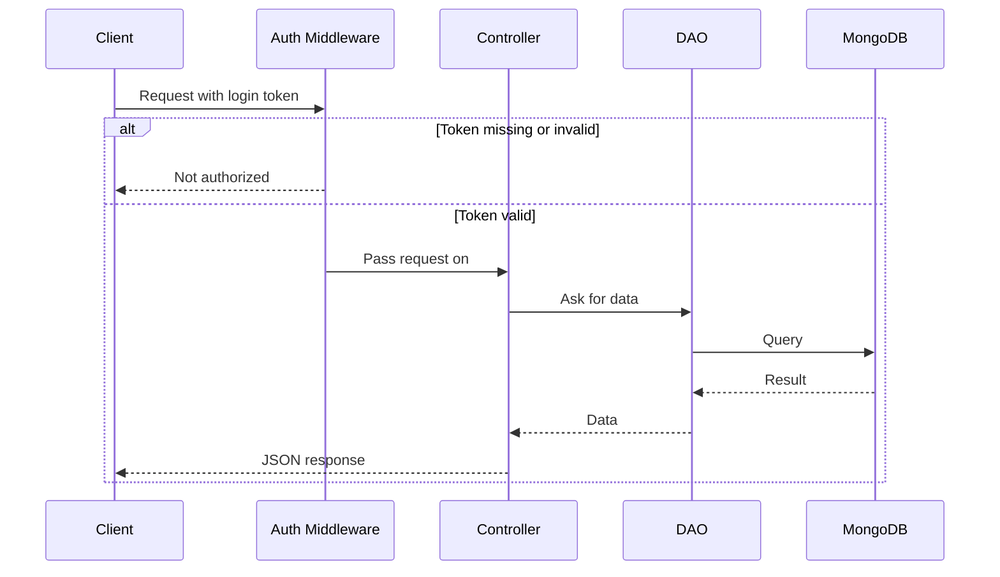

<div align="center">

# 🔗 SocialLink

### A feature-rich social media backend, built with Node.js, Express & MongoDB

Posts, stories, highlights, follows, notes and more, all behind a clean REST API.

[](https://nodejs.org/)
[](https://expressjs.com/)
[](https://www.mongodb.com/)
[](https://jwt.io/)
[](https://cloudinary.com/)
[](https://codespaces.new/adeebmansoor/SocialLink)

**👇 Jump to a section**

[✨ Features](#-features) •
[🧰 Tech Stack](#-tech-stack) •
[🧱 Architecture](#-architecture) •
[🚀 Quick Start](#-quick-start) •
[🔐 Environment](#-environment-variables) •
[🔌 API](#-api-reference) •
[📁 Structure](#-project-structure) •
[🧭 Roadmap](#-roadmap)

</div>

---

## ✨ Features

| | Feature | What you get |
|---|---------|--------------|
| 🔑 | **Authentication** | Register and log in with JWT, or sign in with **Google**. Sessions are stored in MongoDB. |
| 📧 | **Password recovery** | Forgot-password emails sent through Nodemailer |
| 📸 | **Posts** | Upload up to 5 images, then like, save, comment, edit, pin or delete |
| 💬 | **Comments** | Comment on posts, like comments, and turn comments or likes on and off per post |
| 📰 | **Feed & discovery** | Personalized home feed, user search and open profiles |
| 🤝 | **Follow system** | Follow and unfollow, browse followers and following, remove followers, search both lists |
| ⏳ | **Stories** | Share image stories, like them, and delete them. Old stories are archived. |
| 🌟 | **Highlights** | Turn stories into permanent highlights with custom covers |
| 📝 | **Notes** | Create and delete short notes |
| 👤 | **Profiles** | Edit your profile and upload a profile picture |
| ⚙️ | **Settings & privacy** | Saved posts, liked posts, your comments, account toggle, block and unblock users |
| ☁️ | **Media storage** | Images stored on Cloudinary |

---

## 🧰 Tech Stack

<details open>
<summary><b>▶ Core</b></summary>

<br>

| Tool | Purpose |
|------|---------|
| Node.js + Express 4 | Server and REST API |
| MongoDB + Mongoose | Database and models |
| JSON Web Tokens | Login tokens |
| bcrypt | Password hashing |
| Passport (local + Google OIDC) | Authentication strategies |
| express-session + connect-mongo | Session storage in MongoDB |

</details>

<details>
<summary><b>▶ Media, email & utilities</b></summary>

<br>

| Tool | Purpose |
|------|---------|
| Multer + multer-storage-cloudinary | Image uploads |
| Cloudinary | Image hosting |
| Nodemailer | Password reset emails |
| cookie-parser | Reading cookies |
| connect-flash | Flash messages |
| Morgan | Request logging |
| dotenv | Environment variables |
| uuid | Unique IDs |
| EJS | View engine |

</details>

---

## 🧱 Architecture

<details open>
<summary><b>▶ Layered design: every request flows through the same path</b></summary>

<br>



Each feature (posts, stories, follows, and so on) has its own route, controller and DAO file, which keeps the code easy to navigate.

</details>

<details>
<summary><b>▶ What happens on a protected request</b></summary>

<br>



</details>

---

## 🚀 Quick Start

<details open>
<summary><b>▶ Run SocialLink locally in 4 steps</b></summary>

<br>

**Prerequisites:** Node.js 18+, a MongoDB database (local or Atlas), a [Cloudinary](https://cloudinary.com/) account and a Gmail account for sending emails.

**1. Clone the repo**

```bash
git clone https://github.com/adeebmansoor/SocialLink.git
cd SocialLink
```

**2. Install dependencies**

```bash
npm install
```

**3. Create a `.env` file** in the project root using the [variables below](#-environment-variables).

**4. Start the server**

```bash
npm run app
```

The API runs on **http://localhost:3000** by default. Visit `/users/home` to check it's alive. 🎉

</details>

<details>
<summary><b>▶ Available scripts</b></summary>

<br>

| Command | What it does |
|---------|--------------|
| `npm run app` | Start the server with auto-reload (nodemon) |
| `npm run nodemon` | Same as above |
| `node server.js` | Start with plain Node, no auto-reload |

</details>

---

## 🔐 Environment Variables

<details open>
<summary><b>▶ Create a <code>.env</code> file in the project root</b></summary>

<br>

| Variable | Description |
|----------|-------------|
| `PORT` | Server port (defaults to `3000`) |
| `MONGO_URI` | MongoDB connection string |
| `JWT_SECRET_KEY` | Long random string used to sign login tokens |
| `GOOGLE_SECRET_KEY` | Google OAuth client secret |
| `CLOUDINARY_CLOUD_NAME` | Your Cloudinary cloud name |
| `CLOUDINARY_API_KEY` | Your Cloudinary API key |
| `CLOUDINARY_API_SECRET` | Your Cloudinary API secret |
| `Email` | Gmail address used to send emails |
| `Password` | Gmail app password for that address |

Example:

```env
PORT=3000
MONGO_URI=your_mongodb_connection_string
JWT_SECRET_KEY=replace_with_a_long_random_string
GOOGLE_SECRET_KEY=your_google_client_secret
CLOUDINARY_CLOUD_NAME=your_cloud_name
CLOUDINARY_API_KEY=your_cloudinary_api_key
CLOUDINARY_API_SECRET=your_cloudinary_api_secret
Email=your_email@gmail.com
Password=your_gmail_app_password
```

</details>

> ⚠️ **Never commit your `.env` file.** It is already listed in `.gitignore`. Use a Gmail *app password*, not your normal password.

---

## 🔌 API Reference

Base URL: `http://localhost:3000`

**Auth column:** ✅ means you must be logged in. A successful login sets a `token` cookie and also returns the token in the JSON response.

<details open>
<summary><b>▶ 🔑 Users and authentication</b> — <code>/users</code></summary>

<br>

| Method | Endpoint | Auth | Description |
|:------:|----------|:----:|-------------|
| `POST` | `/users/register` | ❌ | Create a new account |
| `POST` | `/users/login` | ❌ | Log in and receive a token |
| `GET` | `/users/login/federated/google` | ❌ | Start Google sign-in |
| `GET` | `/users/oauth2/redirect/google` | ❌ | Google sign-in callback |
| `GET` | `/users/loginuser` | ✅ | Get the logged-in user |
| `GET` | `/users/logout` | ✅ | Log out |
| `POST` | `/users/forgotpassword` | ❌ | Send a password reset email |
| `POST` | `/users/newpassword` | ❌ | Set a new password after reset |
| `POST` | `/users/resetpassword` | ✅ | Change password while logged in |
| `GET` | `/users/totalusers` | ❌ | Total number of users |
| `GET` | `/users/home` | ❌ | Home / health check page |

</details>

<details>
<summary><b>▶ 👤 Profile</b> — <code>/profile</code></summary>

<br>

| Method | Endpoint | Auth | Description |
|:------:|----------|:----:|-------------|
| `GET` | `/profile/loginuser` | ✅ | Get your profile |
| `POST` | `/profile/uploadprofile` | ✅ | Upload a profile picture (file field: `profile`) |
| `POST` | `/profile/edit/profile` | ✅ | Edit profile details |

</details>

<details>
<summary><b>▶ 📸 Posts</b> — <code>/posts</code></summary>

<br>

| Method | Endpoint | Auth | Description |
|:------:|----------|:----:|-------------|
| `POST` | `/posts/upload/post` | ✅ | Create a post with up to 5 images (file field: `image`) |
| `PUT` | `/posts/like/post` | ✅ | Like or unlike a post |
| `PUT` | `/posts/save` | ✅ | Save or unsave a post |
| `POST` | `/posts/comment` | ✅ | Add a comment |
| `GET` | `/posts/view/comments` | ✅ | View comments on a post |
| `PUT` | `/posts/comment/like` | ✅ | Like a comment |
| `GET` | `/posts/post/likes/:postId` | ✅ | See who liked a post |
| `GET` | `/posts/post/likes/users` | ✅ | Search users who liked a post |
| `GET` | `/posts/open` | ✅ | Open another user's post |
| `GET` | `/posts/myposts/open/:postId` | ✅ | Open one of your own posts |
| `PUT` | `/posts/comments/toggle` | ✅ | Turn comments on or off |
| `PUT` | `/posts/likes/toggle` | ✅ | Turn likes on or off |
| `PUT` | `/posts/pin/toggle` | ✅ | Pin or unpin a post |
| `GET` | `/posts/edit` | ✅ | Load a post for editing |
| `PUT` | `/posts/edit` | ✅ | Save post edits |
| `DELETE` | `/posts/delete/:postId` | ✅ | Delete a post |

</details>

<details>
<summary><b>▶ 📰 Feed & discovery</b> — <code>/feed</code></summary>

<br>

| Method | Endpoint | Auth | Description |
|:------:|----------|:----:|-------------|
| `GET` | `/feed/home` | ✅ | Your home feed |
| `GET` | `/feed/users` | ✅ | Search for users |
| `GET` | `/feed/openprofile/:userId` | ✅ | Open another user's profile |

</details>

<details>
<summary><b>▶ 🤝 Follows</b> — <code>/follows</code></summary>

<br>

| Method | Endpoint | Auth | Description |
|:------:|----------|:----:|-------------|
| `PUT` | `/follows/follow` | ✅ | Follow or unfollow a user |
| `GET` | `/follows/followers/:userId` | ✅ | A user's followers |
| `GET` | `/follows/followings/:userId` | ✅ | Who a user follows |
| `GET` | `/follows/myfollowers` | ✅ | Your followers |
| `GET` | `/follows/myfollowing` | ✅ | People you follow |
| `DELETE` | `/follows/myfollowers/remove` | ✅ | Remove one of your followers |
| `GET` | `/follows/search/followers` | ✅ | Search your followers |
| `GET` | `/follows/search/following` | ✅ | Search people you follow |

</details>

<details>
<summary><b>▶ ⏳ Stories</b> — <code>/stories</code></summary>

<br>

| Method | Endpoint | Auth | Description |
|:------:|----------|:----:|-------------|
| `POST` | `/stories/add/story` | ✅ | Add a story (file field: `storyimage`) |
| `GET` | `/stories/get/stories` | ✅ | Get stories |
| `GET` | `/stories/get/story/:id` | ✅ | Open a single story |
| `PUT` | `/stories/story/like` | ✅ | Like a story |
| `DELETE` | `/stories/story/delete/:storyId` | ✅ | Delete a story |

</details>

<details>
<summary><b>▶ 🌟 Highlights</b> — <code>/highlights</code></summary>

<br>

| Method | Endpoint | Auth | Description |
|:------:|----------|:----:|-------------|
| `GET` | `/highlights/getstories` | ✅ | Stories available to add to a highlight |
| `POST` | `/highlights/upload` | ✅ | Create a highlight (file field: `coverimage`) |
| `PUT` | `/highlights/add/cover` | ✅ | Set a highlight cover |
| `GET` | `/highlights/gethighlights` | ✅ | Get highlights |
| `GET` | `/highlights/gethighlights/loginuser` | ✅ | Get your highlights |
| `GET` | `/highlights/gethighlights/:id` | ✅ | Open a single highlight |
| `DELETE` | `/highlights/delete/:id` | ✅ | Delete a highlight |

</details>

<details>
<summary><b>▶ 📝 Notes</b> — <code>/notes</code></summary>

<br>

| Method | Endpoint | Auth | Description |
|:------:|----------|:----:|-------------|
| `POST` | `/notes/createnote` | ✅ | Create a note |
| `PUT` | `/notes/deletenote` | ✅ | Delete a note |

</details>

<details>
<summary><b>▶ ⚙️ Settings & privacy</b> — <code>/settings</code></summary>

<br>

| Method | Endpoint | Auth | Description |
|:------:|----------|:----:|-------------|
| `GET` | `/settings/saved/posts` | ✅ | Your saved posts |
| `GET` | `/settings/saved/posts/open/:userId` | ✅ | Open saved posts |
| `GET` | `/settings/user/likes` | ✅ | Posts you liked |
| `GET` | `/settings/liked/posts` | ✅ | Liked posts |
| `GET` | `/settings/user/comments` | ✅ | Your comments on posts |
| `GET` | `/settings/user/posts` | ✅ | Your posts |
| `GET` | `/settings/user/posts/open/:postId` | ✅ | Open one of your posts |
| `GET` | `/settings/user/posts/comments/:postId` | ✅ | Comments on one of your posts |
| `GET` | `/settings/user/highlights` | ✅ | Your highlights |
| `GET` | `/settings/user/singlehighlight/:highlightId` | ✅ | Open one highlight |
| `GET` | `/settings/archieve/story/:storyId` | ✅ | Open an archived story |
| `DELETE` | `/settings/content/removed` | ✅ | Remove your content |
| `GET` | `/settings/aboutus` | ✅ | About the logged-in account |
| `PUT` | `/settings/account/toggle` | ✅ | Toggle account setting |
| `PUT` | `/settings/resetpassword` | ✅ | Reset your password |
| `PUT` | `/settings/block/user` | ✅ | Block a user |
| `GET` | `/settings/blocked/accounts` | ✅ | List blocked accounts |
| `PUT` | `/settings/unblock/user` | ✅ | Unblock a user |

</details>

<details>
<summary><b>▶ 🧪 Try it with cURL</b></summary>

<br>

```bash
# Register
curl -X POST http://localhost:3000/users/register \
  -H "Content-Type: application/json" \
  -d '{"username":"demo","fullname":"Demo User","email":"demo@example.com","password":"Secret123"}'

# Log in and save the cookie
curl -X POST http://localhost:3000/users/login \
  -H "Content-Type: application/json" \
  -c cookies.txt \
  -d '{"email":"demo@example.com","password":"Secret123"}'

# Call a protected route with the saved cookie
curl http://localhost:3000/feed/home -b cookies.txt
```

</details>

---

## 📁 Project Structure

<details>
<summary><b>▶ Click to expand the file tree</b></summary>

<br>

```text
SocialLink/
├── config/
│   ├── cloudinary.config.js     # Cloudinary setup
│   └── db.config.js             # MongoDB connection
│
├── controllers/                 # Request handlers
│   ├── user.controllers.js
│   ├── post.controllers.js
│   ├── feed.controllers.js
│   ├── follow.controllers.js
│   ├── story.controllers.js
│   ├── highlights.controllers.js
│   ├── notes.controllers.js
│   ├── profile.controllers.js
│   └── settings.controllers.js
│
├── Dao/                         # Database access layer
│   ├── user.dao.js
│   ├── post.dao.js
│   ├── feed.dao.js
│   ├── follow.dao.js
│   ├── story.dao.js
│   ├── highlights.dao.js
│   ├── notes.dao.js
│   ├── profile.dao.js
│   └── settings.dao.js
│
├── middlewares/
│   ├── auth.middleware.js       # Checks the login token
│   └── images.middleware.js     # Handles image uploads
│
├── models/                      # Mongoose schemas
│   ├── user.model.js
│   ├── post.model.js
│   ├── comments.model.js
│   ├── story.model.js
│   └── highlights.model.js
│
├── routes/                      # One router per feature
│   ├── user.routes.js
│   ├── post.routes.js
│   ├── feed.routes.js
│   ├── follow.routes.js
│   ├── story.routes.js
│   ├── highlights.routes.js
│   ├── notes.routes.js
│   ├── profile.routes.js
│   └── settings.routes.js
│
├── utils/
│   ├── date.utils.js
│   └── sendtoken.utils.js       # Issues the JWT cookie
│
├── app.js                       # Express app, sessions, route mounting
├── server.js                    # Entry point
└── package.json
```

</details>

---

## 🧭 Roadmap

- [x] User authentication (JWT + Google sign-in)
- [x] Posts, comments, likes and saves
- [x] Follow system
- [x] Stories and highlights
- [x] Notes, profiles and settings
- [x] Block and unblock users
- [ ] Real-time notifications with Socket.io
- [ ] AI-powered content suggestions and engagement tips
- [ ] Automated tests
- [ ] API documentation with Swagger

---

## 🤝 Contributing

1. Fork the repo
2. Create your branch: `git checkout -b feature/amazing-feature`
3. Commit your changes: `git commit -m "Add amazing feature"`
4. Push the branch: `git push origin feature/amazing-feature`
5. Open a pull request

---

## 👨‍💻 Author

**Adeeb Mansoor**

[](https://github.com/adeebmansoor/)

---

<div align="center">

⭐ If SocialLink helps you, give it a star!

*Connect. Share. Grow.* 🚀

</div>
